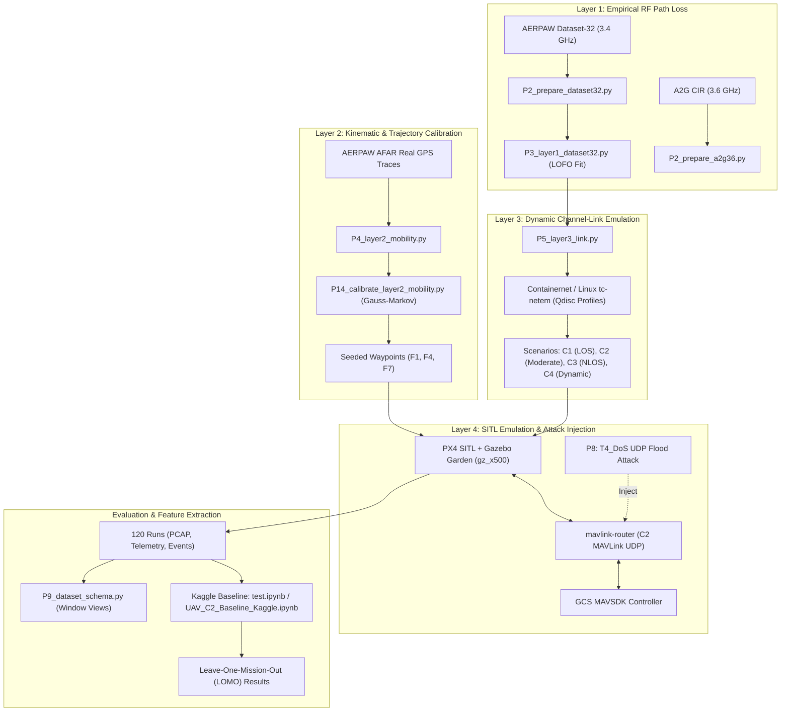

# UAV C2 IDS: Measurement-Calibrated Digital Twin & Intrusion Detection Evaluation

[](https://www.python.org/downloads/)
[](https://ubuntu.com/)
[](https://docs.px4.io/v1.14/en/)
[](https://gazebosim.org/)
[](https://www.kaggle.com/datasets/nguyen273mmb/uav-c2-pcap)

This repository contains the source code, empirical calibration pipeline, processed data, and baseline machine learning evaluations for the **UAV Command-and-Control (C2) Cyber-Physical Digital Twin and Intrusion Detection System (IDS)**.

The framework couples **PX4 SITL / Gazebo Garden** flight simulation, **MAVLink** command-and-control telemetry, and **Containernet** software-defined network emulation. The digital twin is calibrated across four layers against public, peer-reviewed empirical UAV flight campaigns (AERPAW Dataset-32, AERPAW AFAR, AERPAW AADM, Pawprints 4G, and Ericsson 5G NSA).

---

## 1. System Architecture: 4-Layer Calibration Pipeline



### Layer Details:
- **Layer 1 (RF Propagation Calibration)**: Empirical distance-dependent log-distance path loss calibrated from AERPAW Dataset-32 ($n \approx 2.578$, $\beta = 25.78$ dB/decade) under Leave-One-Flight-Out validation, with cross-domain comparative checks against 3.6 GHz CIR.
- **Layer 2 (Mobility & Kinematics)**: Real-world GPS waypoint sequences from AERPAW AFAR testbed flights. Velocity dynamics fitted via a Gauss-Markov autoregressive process ($\alpha = 0.970$, $\mu = 3.05$ m/s, $\sigma = 0.438$ m/s) with 95th-percentile corner turn-rate speed caps.
- **Layer 3 (Channel & Network Emulation)**: Software-defined link emulation in Containernet using Linux `tc/netem` to enforce four propagation regimes (`C1_LOS`, `C2_Moderate`, `C3_NLOS`, `C4_Dynamic`).
- **Layer 4 (Cyber-Physical SITL & Traffic Generation)**: PX4 Autopilot SITL (`HEADLESS=1 make px4_sitl gz_x500`) coupled with MAVSDK ground station control, `mavlink-router`, and in-path C2 attack injection (T0 Benign vs. T4 DoS flood).

---

## 2. Experimental Campaign Matrix (120 Runs)

The multi-run campaign executes a balanced $3 \times 4 \times 2 \times 5 = 120$ factor design:

| Factor | Values | Description |
| :--- | :---: | :--- |
| **Missions ($N=3$)** | `F1`, `F4`, `F7` | AFAR real-world GPS waypoint routes (distinct flight geometries) |
| **Channel Scenarios ($N=4$)** | `C1_LOS`, `C2_Moderate`, `C3_NLOS`, `C4_Dynamic` | Physics-calibrated link degradation and shadowing conditions |
| **Traffic Classes ($N=2$)** | `T0_Benign`, `T4_DoS` | Nominal C2 telemetry/commands vs. targeted UDP flood on GCS endpoint |
| **Seeds ($N=5$)** | `s1`, `s2`, `s3`, `s4`, `s5` | Random seed controlling Gauss-Markov speeds, offsets, and packet timing |

---

## 3. Repository Directory Structure

```text
uav_c2_ids/
├── src/                                  # Pipeline source code
│   ├── pipeline/                         # Four-layer calibration & emulation modules
│   │   ├── P2_prepare_dataset32.py       # Layer 1: Dataset-32 extractor & provenance
│   │   ├── P3_layer1_dataset32.py        # Layer 1: Log-distance path loss fitting
│   │   ├── P4_layer2_mobility.py         # Layer 2: AFAR GPS trace normalization
│   │   ├── P14_calibrate_layer2_mobility.py # Layer 2: Gauss-Markov velocity calibration
│   │   ├── P5_layer3_link.py             # Layer 3: Dynamic tc/netem link configuration
│   │   ├── P7_sitl_c2_twin.py            # Layer 4: PX4 SITL + Gazebo Garden C2 twin
│   │   ├── P8_run_campaign.py            # Layer 4: Multi-run campaign orchestrator
│   │   ├── P9_dataset_schema.py          # Windowed feature and schema extractor
│   │   ├── P10_ids.py                    # IDS evaluation script
│   │   ├── Dockerfile.sitl               # Container image definition for PX4/Gazebo SITL
│   │   ├── run_all.sh                    # Automated end-to-end execution pipeline
│   │   └── scripts/                      # MAVSDK mission runner and manifest utilities
│   └── monitor.py                        # Terminal-based campaign execution monitor
├── data/                                 # Calibrated artifacts and trajectory data
│   ├── missions/                         # 15 normalized AFAR GPS waypoint traces (.csv)
│   ├── model_fits/                       # Fitted Layer 1-3 parameter cards (.json)
│   ├── processed/                        # Processed empirical dataset extracts
│   │   ├── dataset32/                    # AERPAW Dataset-32 path loss table & manifest
│   │   ├── aerpaw5g/                     # AERPAW 5G NSA KPIs & manifest
│   │   └── pawprints4g/                  # Pawprints 4G LTE KPIs & manifest
│   └── campaign_results/                 # Documentation & link to 120-run raw PCAP archive
├── config/                               # RF channel sounding & antenna configurations
│   ├── a2g_500m/                         # Air-to-ground 500m link configurations
│   ├── f2f/                              # Flight-to-flight configurations
│   └── power_cal_data.csv                # USRP power calibration reference
├── test.ipynb                            # Kaggle baseline evaluation notebook (executed outputs)
├── UAV_C2_Baseline_Kaggle.ipynb          # End-to-end Kaggle baseline ML notebook
├── model_metrics.csv                     # Model evaluation metrics across all folds
├── model_metrics_per_fold.csv            # Detailed fold-level metrics (F1, F4, F7 held out)
├── model_metrics_summary.csv             # Aggregated mean and std metrics per model
├── tree_feature_importance_mean.csv      # Feature importance rankings
├── split_manifest.json                   # Partition manifest for reproducible LOMO splits
├── oof_predictions.csv.gz                # Out-of-fold predictions (gzip compressed)
├── testplan.txt                          # Experimental test plan specification
├── replan.txt                            # Digital twin architecture & calibration specification
├── audit_data.py                         # Comprehensive campaign audit script
├── test_data_quality.py                  # PCAP & telemetry integrity verification
└── generate_final_report.py              # Campaign statistical summary generator
```

---

## 4. Baseline Machine Learning Evaluation (Kaggle)

Models are evaluated using **Leave-One-Mission-Out (LOMO)** cross-validation on 1-second non-overlapping time windows extracted from the C2 packet captures. In each fold, an entire flight mission (`F1`, `F4`, or `F7`) is completely held out as the test set:

### Benchmark Summary (Primary 1-Second Window LOMO Evaluation)

| Model | Balanced Acc (Mean ± Std) | Macro-F1 (Mean ± Std) | DoS F1 (Mean ± Std) | PR-AUC (Mean ± Std) | ROC-AUC (Mean ± Std) | Latency (ms/win) |
| :--- | :---: | :---: | :---: | :---: | :---: | :---: |
| **HistGradientBoosting** | **0.450 ± 0.104** | **0.426 ± 0.140** | **0.438 ± 0.171** | **0.434 ± 0.239** | 0.393 ± 0.188 | 0.0065 ms |
| **RandomForest** | 0.440 ± 0.105 | 0.417 ± 0.138 | 0.425 ± 0.172 | 0.437 ± 0.243 | **0.399 ± 0.179** | 0.0116 ms |
| **ExtraTrees** | 0.439 ± 0.110 | 0.413 ± 0.134 | 0.443 ± 0.196 | **0.440 ± 0.246** | 0.397 ± 0.198 | 0.0119 ms |
| **DecisionTree** | 0.426 ± 0.092 | 0.390 ± 0.115 | 0.460 ± 0.194 | 0.417 ± 0.223 | 0.405 ± 0.174 | 0.0007 ms |
| **LogisticRegression** | 0.433 ± 0.097 | 0.366 ± 0.107 | 0.505 ± 0.216 | 0.429 ± 0.229 | 0.381 ± 0.186 | 0.0008 ms |
| **GaussianNB** | 0.370 ± 0.148 | 0.290 ± 0.053 | 0.444 ± 0.339 | 0.401 ± 0.211 | 0.373 ± 0.151 | 0.0013 ms |
| *Dummy (Most Frequent)* | 0.500 ± 0.000 | 0.282 ± 0.071 | 0.134 ± 0.233 | 0.433 ± 0.159 | 0.500 ± 0.000 | 0.0006 ms |

> **Key Finding**: LOMO evaluation demonstrates that when an entire flight mission profile is held out, tree-based ensemble models (HistGradientBoosting, RandomForest, ExtraTrees) exhibit more robust cross-mission generalization than linear or naive Bayes classifiers.

---

## 5. Quickstart & Reproduction

### Option A: Run Baseline ML on Kaggle
1. Upload or attach the dataset: [nguyen273mmb/uav-c2-pcap](https://www.kaggle.com/datasets/nguyen273mmb/uav-c2-pcap).
2. Open [`test.ipynb`](test.ipynb) or [`UAV_C2_Baseline_Kaggle.ipynb`](UAV_C2_Baseline_Kaggle.ipynb).
3. Run all cells to replicate the feature pruning, model training, and LOMO evaluation metrics.

### Option B: Decompress Out-of-Fold Predictions
The full out-of-fold prediction table (`oof_predictions.csv`, 210 MB) is provided in compressed format (`oof_predictions.csv.gz`, 9.7 MB):
```bash
gzip -dk oof_predictions.csv.gz
```

### Option C: Reproduce the Calibration Pipeline Locally (Linux / WSL2)
1. Install Python dependencies:
   ```bash
   pip install -r src/pipeline/requirements.txt
   ```
2. Run Layer 1 & Layer 2 calibrations:
   ```bash
   python src/pipeline/P2_prepare_dataset32.py --output_dir data/processed/dataset32
   python src/pipeline/P3_layer1_dataset32.py --input_csv data/processed/dataset32/dataset32_pathloss.csv --output_dir data/model_fits
   python src/pipeline/P14_calibrate_layer2_mobility.py --missions_dir data/missions --output_dir data/model_fits
   ```
3. To run the full SITL simulation campaign (requires Docker, PX4 SITL, and Containernet):
   ```bash
   docker build -t uav-cas-sitl:latest -f src/pipeline/Dockerfile.sitl .
   bash src/pipeline/run_all.sh
   ```

### Option D: Audit Campaign Quality
Validate PCAP packet counts, telemetry timestamp alignment, and attack interval overlaps across all runs:
```bash
python audit_data.py
python test_data_quality.py
```

---

## 6. Scientific References

1. **AERPAW Dataset-32**: Air-to-Ground Channel Sounding and Path Loss Measurements at 3.4 GHz with Linear and Zigzag UAV Trajectories (AERPAW Consortium, 2024).
2. **AERPAW AFAR Challenge**: Collection of UAV-Based RSS Measurements From the AFAR Challenge in Digital Twin and Real-World Environments (IEEE Data Descriptions, 2025).
3. **AERPAW AADM Challenge**: Autonomous Data Mule Challenge in Digital Twin and Real-World Environments (Dataset-30, arXiv:2602.16163).
4. **PX4 Autopilot**: An Open-Source Flight Control System for Autonomous Vehicles ([px4.io](https://px4.io/)).

---

## 7. License

This repository is distributed under the Apache License 2.0. See [`LICENSE`](LICENSE) for details.
